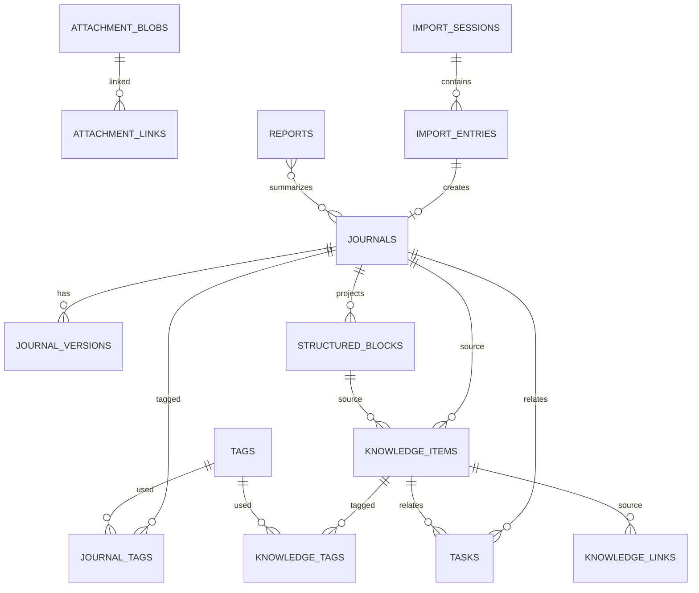

# DailyFlow 数据库设计

## 1. 设计目标

本设计同时约束两种存储实现：

- 桌面端：SQLite，由 Rust 持久化层管理。
- Web 端：IndexedDB，由 Dexie 管理。

两端不要求物理 schema 相同，但必须保持以下逻辑契约一致：

- 同一实体标识、时间语义、状态枚举和 revision 语义。
- 同一 Repository 方法在两端产生等价业务结果。
- 日志正文、结构化投影、搜索文档和版本检查点在同一事务中提交。
- 数据库迁移只前进，不允许静默修改已发布迁移。

## 2. 通用约定

### 2.1 标识

- 主键使用 UUIDv7，字符串形式为 36 字符，例如 `0198e2f4-7e33-7c70-a8b2-18c1520f9c26`。
- UUIDv7 由客户端生成，便于离线创建、时间有序和未来同步。
- 不使用自增整数作为跨表或对 UI 暴露的业务 ID。
- 未来服务端必须接受客户端生成的 ID，不能重新分配业务 ID。

### 2.2 时间

| 字段类型 | 格式 | 含义 |
| --- | --- | --- |
| `created_at`、`updated_at`、`deleted_at`、`completed_at` | UTC ISO 8601，如 `2026-10-30T03:20:11.123Z` | 精确时刻 |
| `journal_date`、`due_date`、`period_start`、`period_end` | `YYYY-MM-DD` | 用户本地日历日期，不随时区转换 |
| `timezone` | IANA 名称，如 `Asia/Shanghai` | 创建日志时的本地时区 |

服务器、数据库和浏览器时区不得用于直接切分日记日期。日期由用户本地日历解释，并在显示时使用同一时区上下文。

### 2.3 版本与删除

- 每个可变聚合有 `revision INTEGER NOT NULL DEFAULT 1`。
- 写入时使用 `WHERE id = ? AND revision = expectedRevision`，更新成功后 `revision = revision + 1`。
- 删除是设置 `deleted_at` 的软删除，不立即物理删除历史、关联和附件。
- 回收站清理、附件孤儿清理和导入原始内容清理是单独的数据管理操作。
- `deleted_at` 非空时，默认查询必须排除该实体。

### 2.4 枚举

SQLite 使用 `TEXT + CHECK`，TypeScript 使用 Zod 枚举。禁止使用无法向前兼容的 SQLite 原生枚举。

核心枚举：

- `journal_status`: `active | archived`
- `knowledge_kind`: `note | issue | solution | decision | reference`
- `knowledge_status`: `active | archived`
- `task_status`: `open | in_progress | done | cancelled`
- `task_priority`: `low | normal | high | urgent`
- `import_status`: `scanning | preview_ready | committing | completed | failed | rolled_back`
- `import_entry_status`: `ready | skipped | conflict | invalid | imported | failed`
- `report_period`: `week | month | year`
- `change_source`: `autosave | explicit | restore | import | migration`

### 2.5 正文

| 字段 | 权威性 | 说明 |
| --- | --- | --- |
| `content_json` | 权威 | Tiptap/ProseMirror 文档 JSON |
| `editor_schema_version` | 权威元数据 | 解释 JSON 所需 schema 版本 |
| `content_markdown` | 派生 | 用于导出、预览和兼容 |
| `content_plain_text` | 派生 | 用于搜索、摘要和统计 |
| `content_hash` | 派生校验 | 对规范化权威 JSON 计算 SHA-256 |

派生字段禁止由 UI 单独更新。搜索索引和结构化投影同样只由保存用例生成。

## 3. SQLite 物理设计

### 3.1 连接参数

```sql
PRAGMA foreign_keys = ON;
PRAGMA journal_mode = WAL;
PRAGMA synchronous = NORMAL;
PRAGMA busy_timeout = 5000;
PRAGMA temp_store = MEMORY;
```

数据库文件建议为 `dailyflow.db`，位置由 Tauri `app_data_dir()` 解析。WAL 和 SHM 文件属于运行期文件，不进入业务备份归档。

### 3.2 schema_migrations

```sql
CREATE TABLE schema_migrations (
  version    INTEGER PRIMARY KEY,
  name       TEXT NOT NULL,
  checksum   TEXT NOT NULL,
  applied_at TEXT NOT NULL
) STRICT;
```

规则：

- 每个迁移文件只应用一次。
- 启动时校验已应用版本的 checksum；不一致直接停止并提示数据版本异常。
- 迁移在事务中执行；失败回滚并保留旧数据库。
- 同时把最高版本写入 `PRAGMA user_version` 作为快速检查，但 `schema_migrations` 是权威记录。
- 不提供自动向下迁移。破坏性迁移前要求用户备份或自动创建一致性快照。

### 3.3 app_metadata 与 settings

```sql
CREATE TABLE app_metadata (
  key        TEXT PRIMARY KEY,
  value_json TEXT NOT NULL CHECK (json_valid(value_json)),
  updated_at TEXT NOT NULL
) STRICT;

CREATE TABLE settings (
  key        TEXT PRIMARY KEY,
  value_json TEXT NOT NULL CHECK (json_valid(value_json)),
  updated_at TEXT NOT NULL
) STRICT;
```

建议元数据键：

- `device_id`
- `database_created_at`
- `last_successful_backup_at`
- `search_index_version`
- `search_index_state`：`ready | stale | rebuilding | failed`
- `editor_schema_version`
- `last_import_batch_id`

`settings` 保存用户偏好，如主题、快捷键配置、周起始日、自动保存间隔。不得保存明文 AI API Key。

### 3.4 journals

```sql
CREATE TABLE journals (
  id                    TEXT PRIMARY KEY CHECK (length(id) = 36),
  journal_date          TEXT NOT NULL CHECK (
                          journal_date GLOB '[0-9][0-9][0-9][0-9]-[0-9][0-9]-[0-9][0-9]'
                        ),
  timezone              TEXT NOT NULL,
  title                 TEXT NOT NULL DEFAULT '',
  content_json          TEXT NOT NULL CHECK (json_valid(content_json)),
  content_markdown      TEXT NOT NULL DEFAULT '',
  content_plain_text    TEXT NOT NULL DEFAULT '',
  editor_schema_version INTEGER NOT NULL CHECK (editor_schema_version > 0),
  projection_version    INTEGER NOT NULL CHECK (projection_version > 0),
  content_hash          TEXT NOT NULL CHECK (length(content_hash) = 64),
  excerpt               TEXT NOT NULL DEFAULT '',
  status                TEXT NOT NULL DEFAULT 'active'
                          CHECK (status IN ('active', 'archived')),
  revision              INTEGER NOT NULL DEFAULT 1 CHECK (revision > 0),
  created_at            TEXT NOT NULL,
  updated_at            TEXT NOT NULL,
  deleted_at            TEXT
) STRICT;

CREATE UNIQUE INDEX ux_journals_active_date
  ON journals(journal_date)
  WHERE deleted_at IS NULL;

CREATE INDEX ix_journals_updated
  ON journals(updated_at DESC)
  WHERE deleted_at IS NULL;

CREATE INDEX ix_journals_status_date
  ON journals(status, journal_date DESC)
  WHERE deleted_at IS NULL;

CREATE INDEX ix_journals_hash
  ON journals(content_hash);
```

约束说明：

- `journal_date` 唯一索引保证一个有效日期只有一篇主日志。
- 导入来源通过 `import_entries.journal_id` 单向追踪，避免 `journals` 与 `import_entries` 互相外键引用形成循环和难以排序的插入依赖。
- `projection_version` 记录 Markdown、纯文本、结构化块和搜索文档投影所用规则版本；规则升级后据此识别需要重建的数据。
- 软删除后可重新创建同日日志，但历史版本仍可通过回收站或备份恢复。
- 标题不能替代正文，空标题日志仍可保存。

### 3.5 journal_versions

```sql
CREATE TABLE journal_versions (
  id                    TEXT PRIMARY KEY CHECK (length(id) = 36),
  journal_id            TEXT NOT NULL,
  revision              INTEGER NOT NULL CHECK (revision > 0),
  title                 TEXT NOT NULL DEFAULT '',
  content_json          TEXT NOT NULL CHECK (json_valid(content_json)),
  content_markdown      TEXT NOT NULL DEFAULT '',
  content_plain_text    TEXT NOT NULL DEFAULT '',
  editor_schema_version INTEGER NOT NULL CHECK (editor_schema_version > 0),
  projection_version    INTEGER NOT NULL CHECK (projection_version > 0),
  content_hash          TEXT NOT NULL CHECK (length(content_hash) = 64),
  change_source         TEXT NOT NULL CHECK (
                          change_source IN ('autosave', 'explicit', 'restore', 'import', 'migration')
                        ),
  created_at            TEXT NOT NULL,
  FOREIGN KEY (journal_id) REFERENCES journals(id) ON DELETE CASCADE
) STRICT;

CREATE UNIQUE INDEX ux_journal_versions_revision
  ON journal_versions(journal_id, revision);

CREATE INDEX ix_journal_versions_created
  ON journal_versions(journal_id, created_at DESC);
```

当前正文保存在 `journals`。检查点插入 `journal_versions`。恢复历史版本时：

1. 读取目标版本。
2. 记录当前 `revision` 作为期望版本。
3. 在当前 `revision + 1` 写入恢复后的正文。
4. 插入 `change_source = 'restore'` 的新版本。
5. 不删除任何旧版本。

### 3.6 structured_blocks

```sql
CREATE TABLE structured_blocks (
  id             TEXT PRIMARY KEY CHECK (length(id) = 36),
  journal_id     TEXT NOT NULL,
  block_type     TEXT NOT NULL CHECK (
                   block_type IN ('issue', 'solution', 'decision', 'note', 'todo')
                 ),
  schema_version INTEGER NOT NULL CHECK (schema_version > 0),
  data_json      TEXT NOT NULL CHECK (json_valid(data_json)),
  order_key      TEXT NOT NULL,
  rendered_text  TEXT NOT NULL DEFAULT '',
  created_at     TEXT NOT NULL,
  updated_at     TEXT NOT NULL,
  deleted_at     TEXT,
  FOREIGN KEY (journal_id) REFERENCES journals(id) ON DELETE CASCADE
) STRICT;

CREATE INDEX ix_structured_blocks_journal_order
  ON structured_blocks(journal_id, order_key)
  WHERE deleted_at IS NULL;

CREATE INDEX ix_structured_blocks_type
  ON structured_blocks(block_type)
  WHERE deleted_at IS NULL;
```

结构化块是权威正文 JSON 的投影。保存时根据 `content_json` 中带稳定 ID 的自定义节点重建对应的 `structured_blocks` 行；任何重建失败都回滚整个保存事务。它们用于查询、统计和提升为知识，不是独立正文副本。

### 3.7 knowledge_items

```sql
CREATE TABLE knowledge_items (
  id                    TEXT PRIMARY KEY CHECK (length(id) = 36),
  kind                  TEXT NOT NULL CHECK (
                          kind IN ('note', 'issue', 'solution', 'decision', 'reference')
                        ),
  status                TEXT NOT NULL DEFAULT 'active'
                          CHECK (status IN ('active', 'archived')),
  title                 TEXT NOT NULL,
  content_json          TEXT NOT NULL CHECK (json_valid(content_json)),
  content_markdown      TEXT NOT NULL DEFAULT '',
  content_plain_text    TEXT NOT NULL DEFAULT '',
  editor_schema_version INTEGER NOT NULL CHECK (editor_schema_version > 0),
  projection_version    INTEGER NOT NULL CHECK (projection_version > 0),
  content_hash          TEXT NOT NULL CHECK (length(content_hash) = 64),
  summary               TEXT NOT NULL DEFAULT '',
  revision              INTEGER NOT NULL DEFAULT 1 CHECK (revision > 0),
  source_journal_id     TEXT,
  source_block_id       TEXT,
  created_at            TEXT NOT NULL,
  updated_at            TEXT NOT NULL,
  deleted_at            TEXT,
  FOREIGN KEY (source_journal_id) REFERENCES journals(id) ON DELETE SET NULL,
  FOREIGN KEY (source_block_id) REFERENCES structured_blocks(id) ON DELETE SET NULL
) STRICT;

CREATE INDEX ix_knowledge_kind_updated
  ON knowledge_items(kind, updated_at DESC)
  WHERE deleted_at IS NULL;

CREATE INDEX ix_knowledge_title
  ON knowledge_items(title COLLATE NOCASE)
  WHERE deleted_at IS NULL;

CREATE INDEX ix_knowledge_source_journal
  ON knowledge_items(source_journal_id)
  WHERE source_journal_id IS NOT NULL;
```

来源字段表示创建时的引用。正文可以继续修改，不回写原日志。`source_journal_id` 与 `source_block_id` 被删除时置空，但知识条目本身保留。

### 3.8 tasks

```sql
CREATE TABLE tasks (
  id                TEXT PRIMARY KEY CHECK (length(id) = 36),
  title             TEXT NOT NULL CHECK (length(trim(title)) > 0),
  description_json  TEXT CHECK (
                      description_json IS NULL OR json_valid(description_json)
                    ),
  description_text  TEXT NOT NULL DEFAULT '',
  status            TEXT NOT NULL DEFAULT 'open'
                      CHECK (status IN ('open', 'in_progress', 'done', 'cancelled')),
  priority          TEXT NOT NULL DEFAULT 'normal'
                      CHECK (priority IN ('low', 'normal', 'high', 'urgent')),
  due_date          TEXT CHECK (
                      due_date IS NULL OR due_date GLOB '[0-9][0-9][0-9][0-9]-[0-9][0-9]-[0-9][0-9]'
                    ),
  completed_at      TEXT,
  journal_id        TEXT,
  knowledge_item_id TEXT,
  revision          INTEGER NOT NULL DEFAULT 1 CHECK (revision > 0),
  created_at        TEXT NOT NULL,
  updated_at        TEXT NOT NULL,
  deleted_at        TEXT,
  FOREIGN KEY (journal_id) REFERENCES journals(id) ON DELETE SET NULL,
  FOREIGN KEY (knowledge_item_id) REFERENCES knowledge_items(id) ON DELETE SET NULL
) STRICT;

CREATE INDEX ix_tasks_open_due
  ON tasks(due_date, priority DESC)
  WHERE deleted_at IS NULL AND status IN ('open', 'in_progress');

CREATE INDEX ix_tasks_status_updated
  ON tasks(status, updated_at DESC)
  WHERE deleted_at IS NULL;

CREATE INDEX ix_tasks_journal
  ON tasks(journal_id)
  WHERE journal_id IS NOT NULL;
```

约束补充：

- `status = 'done'` 时业务层要求 `completed_at` 非空；其他状态要求为空。
- 该约束可在 Service 层校验，也可增加 SQLite trigger，二选一，避免两套规则漂移。
- V1 不建重复任务、子任务和提醒引擎表。

### 3.9 tags、journal_tags、knowledge_tags

```sql
CREATE TABLE tags (
  id              TEXT PRIMARY KEY CHECK (length(id) = 36),
  name            TEXT NOT NULL,
  name_normalized TEXT NOT NULL,
  color           TEXT,
  created_at      TEXT NOT NULL,
  updated_at      TEXT NOT NULL
) STRICT;

CREATE UNIQUE INDEX ux_tags_name_normalized
  ON tags(name_normalized);

CREATE TABLE journal_tags (
  journal_id TEXT NOT NULL,
  tag_id     TEXT NOT NULL,
  PRIMARY KEY (journal_id, tag_id),
  FOREIGN KEY (journal_id) REFERENCES journals(id) ON DELETE CASCADE,
  FOREIGN KEY (tag_id) REFERENCES tags(id) ON DELETE CASCADE
) STRICT;

CREATE TABLE knowledge_tags (
  knowledge_item_id TEXT NOT NULL,
  tag_id            TEXT NOT NULL,
  PRIMARY KEY (knowledge_item_id, tag_id),
  FOREIGN KEY (knowledge_item_id) REFERENCES knowledge_items(id) ON DELETE CASCADE,
  FOREIGN KEY (tag_id) REFERENCES tags(id) ON DELETE CASCADE
) STRICT;

CREATE INDEX ix_journal_tags_tag ON journal_tags(tag_id, journal_id);
CREATE INDEX ix_knowledge_tags_tag ON knowledge_tags(tag_id, knowledge_item_id);
```

`name_normalized` 使用共享规则：Unicode NFKC、去首尾空白、折叠连续空白、英文转小写。保留用户输入的 `name` 用于展示。

### 3.10 knowledge_links

```sql
CREATE TABLE knowledge_links (
  id               TEXT PRIMARY KEY CHECK (length(id) = 36),
  source_item_id   TEXT NOT NULL,
  target_item_id   TEXT NOT NULL,
  relation_type    TEXT NOT NULL CHECK (
                     relation_type IN ('related', 'solves', 'caused_by', 'references', 'supersedes')
                   ),
  created_at       TEXT NOT NULL,
  FOREIGN KEY (source_item_id) REFERENCES knowledge_items(id) ON DELETE CASCADE,
  FOREIGN KEY (target_item_id) REFERENCES knowledge_items(id) ON DELETE CASCADE
) STRICT;

CREATE UNIQUE INDEX ux_knowledge_links_relation
  ON knowledge_links(source_item_id, target_item_id, relation_type);

CREATE INDEX ix_knowledge_links_target
  ON knowledge_links(target_item_id, relation_type);
```

`solves` 表示来源条目解决目标问题，方向必须在应用层规范化：`solution --solves--> issue`。

### 3.11 attachment_blobs 与 attachment_links

```sql
CREATE TABLE attachment_blobs (
  id            TEXT PRIMARY KEY CHECK (length(id) = 36),
  sha256        TEXT NOT NULL CHECK (length(sha256) = 64),
  byte_size     INTEGER NOT NULL CHECK (byte_size >= 0),
  mime_type     TEXT NOT NULL,
  storage_kind  TEXT NOT NULL CHECK (storage_kind IN ('desktop-file', 'web-blob')),
  storage_key   TEXT NOT NULL,
  created_at    TEXT NOT NULL,
  orphaned_at   TEXT
) STRICT;

CREATE UNIQUE INDEX ux_attachment_blobs_hash
  ON attachment_blobs(sha256, byte_size);

CREATE TABLE attachment_links (
  id             TEXT PRIMARY KEY CHECK (length(id) = 36),
  blob_id        TEXT NOT NULL,
  owner_type     TEXT NOT NULL CHECK (
                   owner_type IN ('journal', 'knowledge_item', 'structured_block')
                 ),
  owner_id       TEXT NOT NULL,
  display_name   TEXT NOT NULL,
  alt_text       TEXT NOT NULL DEFAULT '',
  is_inline      INTEGER NOT NULL DEFAULT 0 CHECK (is_inline IN (0, 1)),
  sort_order     INTEGER NOT NULL DEFAULT 0,
  created_at     TEXT NOT NULL,
  deleted_at     TEXT,
  FOREIGN KEY (blob_id) REFERENCES attachment_blobs(id) ON DELETE RESTRICT
) STRICT;

CREATE INDEX ix_attachment_links_owner
  ON attachment_links(owner_type, owner_id, created_at)
  WHERE deleted_at IS NULL;

CREATE INDEX ix_attachment_links_blob
  ON attachment_links(blob_id)
  WHERE deleted_at IS NULL;

CREATE INDEX ix_attachment_blobs_orphaned
  ON attachment_blobs(orphaned_at)
  WHERE orphaned_at IS NOT NULL;
```

桌面端 `storage_key` 是相对于应用数据目录的逻辑路径，例如 `attachments/ab/cd/<sha256>.bin`，使用 `/` 作为持久化分隔符，绝不存绝对路径。Web 端 `storage_key` 是 IndexedDB blob store 的键。

多态 owner 无法使用普通外键级联，因此删除实体后由一致性检查将无引用 link 标记删除，再由清理任务处理 blob。附件清理不能与日志删除在同一用户操作中强制完成。

### 3.12 import_sessions 与 import_entries

```sql
CREATE TABLE import_sessions (
  id              TEXT PRIMARY KEY CHECK (length(id) = 36),
  root_label      TEXT NOT NULL,
  status          TEXT NOT NULL CHECK (
                    status IN ('scanning', 'preview_ready', 'committing', 'completed', 'failed', 'rolled_back')
                  ),
  options_json    TEXT NOT NULL DEFAULT '{}' CHECK (json_valid(options_json)),
  revision        INTEGER NOT NULL DEFAULT 1 CHECK (revision > 0),
  scanned_count   INTEGER NOT NULL DEFAULT 0 CHECK (scanned_count >= 0),
  ready_count     INTEGER NOT NULL DEFAULT 0 CHECK (ready_count >= 0),
  imported_count  INTEGER NOT NULL DEFAULT 0 CHECK (imported_count >= 0),
  skipped_count   INTEGER NOT NULL DEFAULT 0 CHECK (skipped_count >= 0),
  conflict_count  INTEGER NOT NULL DEFAULT 0 CHECK (conflict_count >= 0),
  invalid_count   INTEGER NOT NULL DEFAULT 0 CHECK (invalid_count >= 0),
  created_at      TEXT NOT NULL,
  completed_at    TEXT,
  error_summary   TEXT
) STRICT;

CREATE TABLE import_entries (
  id                       TEXT PRIMARY KEY CHECK (length(id) = 36),
  session_id               TEXT NOT NULL,
  relative_path            TEXT NOT NULL,
  original_file_name       TEXT NOT NULL,
  detected_date            TEXT CHECK (
                             detected_date IS NULL OR detected_date GLOB '[0-9][0-9][0-9][0-9]-[0-9][0-9]-[0-9][0-9]'
                           ),
  encoding                 TEXT NOT NULL DEFAULT 'unknown',
  newline_style            TEXT NOT NULL DEFAULT 'unknown'
                             CHECK (newline_style IN ('lf', 'crlf', 'mixed', 'unknown')),
  file_sha256              TEXT CHECK (file_sha256 IS NULL OR length(file_sha256) = 64),
  raw_size                 INTEGER CHECK (raw_size IS NULL OR raw_size >= 0),
  raw_capture_status       TEXT NOT NULL CHECK (
                             raw_capture_status IN ('captured', 'cleaned', 'unavailable')
                           ),
  raw_bytes                BLOB,
  raw_cleaned_at           TEXT,
  status                   TEXT NOT NULL CHECK (
                             status IN ('ready', 'skipped', 'conflict', 'invalid', 'imported', 'failed')
                           ),
  conflict_kind            TEXT,
  error_code               TEXT,
  error_detail             TEXT,
  journal_id               TEXT,
  previous_journal_revision INTEGER,
  created_at               TEXT NOT NULL,
  committed_at             TEXT,
  FOREIGN KEY (session_id) REFERENCES import_sessions(id) ON DELETE CASCADE,
  FOREIGN KEY (journal_id) REFERENCES journals(id) ON DELETE SET NULL,
  CHECK (
    (
      raw_capture_status = 'captured'
      AND raw_bytes IS NOT NULL
      AND raw_cleaned_at IS NULL
      AND file_sha256 IS NOT NULL
      AND raw_size IS NOT NULL
    )
    OR
    (
      raw_capture_status = 'cleaned'
      AND raw_bytes IS NULL
      AND raw_cleaned_at IS NOT NULL
      AND file_sha256 IS NOT NULL
      AND raw_size IS NOT NULL
    )
    OR
    (
      raw_capture_status = 'unavailable'
      AND raw_bytes IS NULL
      AND raw_cleaned_at IS NULL
      AND file_sha256 IS NULL
    )
  )
) STRICT;

CREATE UNIQUE INDEX ux_import_entries_session_path
  ON import_entries(session_id, relative_path);

CREATE INDEX ix_import_entries_session_status
  ON import_entries(session_id, status);

CREATE INDEX ix_import_entries_hash
  ON import_entries(file_sha256);
```

`raw_capture_status` 明确区分三种互斥状态：

- `captured`：原始字节已成功读取，`raw_bytes`、`file_sha256` 和 `raw_size` 非空。
- `cleaned`：原有字节已成功读取，但用户明确清理了内容；保留 `file_sha256`、`raw_size` 和 `raw_cleaned_at`。
- `unavailable`：文件枚举成功但读取失败，无法计算哈希；只保留路径、错误码和可获得的文件元数据。`raw_size` 可为空，不能把读取失败伪装成“已清理”。

`raw_bytes` 保证即使转换失败或未来解析器更新，也能恢复原始文件。默认保留；用户明确清理后改为 `NULL` 并写入 `raw_cleaned_at`。`FILE_READ_FAILED` 条目必须是 `unavailable`，且不参与内容哈希去重。

导入流程包含以下持久化事务边界：

1. 扫描会话审计事务：创建 `import_sessions` 的 `scanning` 记录；随后以独立事务原子写入预览条目、统计并把会话推进为 `preview_ready`。这些操作不创建正式 Journal。
2. 提交开始审计事务：用户确认后，校验 `expected_session_revision`，在短事务中把 `preview_ready` 推进为 `committing` 并使 `revision + 1`；不写正式业务表。
3. 正式数据事务：在单个事务中再次校验会话为 `committing` 且 revision 未变，写入 Journal、版本、结构化投影、标签、搜索文档和附件关联，更新选中 `import_entries` 的 `journal_id/status`，最后把 `import_sessions.status=completed` 并使 `revision + 1`。任一步失败时，该事务整体回滚，不留下部分正式数据或“部分已导入”条目。

正式数据事务回滚后，Application 通过独立审计事务把会话标记为 `failed` 或 `rolled_back`，写入 `error_summary`，并把失败条目标记为 `failed` 及对应的 `error_code/error_detail`。审计事务只能写 `import_sessions`、`import_entries` 的错误状态，不能再写 Journal、版本、投影或搜索索引。审计事务本身失败时，允许保留 `preview_ready` 状态，但启动后的恢复检查必须把中断的 `committing` 会话标记为 `failed`；不得据此恢复出正式业务数据。

`import_sessions.revision` 初始为 1，之后保存预览、进入 `committing`、提交成功或记录失败时每次递增 1。应用只传 `expectedSessionRevision`，不直接写状态字段；不匹配时返回 `CONFLICT`，防止同一预览被并发或重复提交。

### 3.13 reports

```sql
CREATE TABLE reports (
  id                TEXT PRIMARY KEY CHECK (length(id) = 36),
  period_type       TEXT NOT NULL CHECK (period_type IN ('week', 'month', 'year')),
  period_start      TEXT NOT NULL,
  period_end        TEXT NOT NULL,
  timezone          TEXT NOT NULL,
  title             TEXT NOT NULL,
  content_json      TEXT NOT NULL CHECK (json_valid(content_json)),
  content_markdown  TEXT NOT NULL DEFAULT '',
  content_plain_text TEXT NOT NULL DEFAULT '',
  editor_schema_version INTEGER NOT NULL CHECK (editor_schema_version > 0),
  projection_version INTEGER NOT NULL CHECK (projection_version > 0),
  stats_json        TEXT NOT NULL CHECK (json_valid(stats_json)),
  generated_by      TEXT NOT NULL DEFAULT 'local'
                      CHECK (generated_by IN ('local', 'ai_assisted')),
  source_watermark  TEXT,
  revision          INTEGER NOT NULL DEFAULT 1 CHECK (revision > 0),
  created_at        TEXT NOT NULL,
  updated_at        TEXT NOT NULL,
  deleted_at        TEXT
) STRICT;

CREATE UNIQUE INDEX ux_reports_period
  ON reports(period_type, period_start, period_end, timezone)
  WHERE deleted_at IS NULL;

CREATE INDEX ix_reports_updated
  ON reports(updated_at DESC)
  WHERE deleted_at IS NULL;
```

`stats_json` 保存生成统计时的口径和数据快照，便于重新打开报告时解释结果。报告正文使用与 Journal 相同的 Tiptap 权威 JSON，`editor_schema_version` 解释正文结构，`projection_version` 标识 Markdown、纯文本和搜索投影规则。报告正文编辑后 `source_watermark` 可保留来源生成时间，不强制实时跟随统计。

### 3.14 搜索索引

搜索文档表可作为 SQLite 普通表保存可重建数据：

```sql
CREATE TABLE search_documents (
  id              TEXT PRIMARY KEY CHECK (length(id) = 36),
  entity_type     TEXT NOT NULL CHECK (
                    entity_type IN ('journal', 'knowledge_item', 'task', 'structured_block')
                  ),
  entity_id       TEXT NOT NULL,
  title           TEXT NOT NULL DEFAULT '',
  body_text       TEXT NOT NULL DEFAULT '',
  structured_text TEXT NOT NULL DEFAULT '',
  tags_text       TEXT NOT NULL DEFAULT '',
  normalized_text TEXT NOT NULL DEFAULT '',
  tokenized_text  TEXT NOT NULL DEFAULT '',
  local_date      TEXT,
  updated_at      TEXT NOT NULL,
  content_hash    TEXT NOT NULL,
  index_version   INTEGER NOT NULL
) STRICT;

CREATE UNIQUE INDEX ux_search_documents_entity
  ON search_documents(entity_type, entity_id);

CREATE INDEX ix_search_documents_date
  ON search_documents(local_date DESC)
  WHERE local_date IS NOT NULL;
```

FTS5 虚拟表由迁移脚本创建，具体列和 CJK 分词策略见 `SEARCH-DESIGN.md`：

```sql
CREATE VIRTUAL TABLE search_fts USING fts5(
  entity_type UNINDEXED,
  entity_id UNINDEXED,
  title,
  body_text,
  structured_text,
  tokenized_text,
  tags_text,
  tokenize = 'unicode61 remove_diacritics 2'
);
```

`search_documents` 与 `search_fts` 必须在同一保存事务中更新；索引版本升级时先标记 `stale`，再离线重建。

### 3.15 数据库迁移文件

建议目录：

```text
apps/desktop/src-tauri/migrations/
├─ 0001_initial.sql
├─ 0002_search_fts.sql
├─ 0003_knowledge_links.sql
└─ ...
```

迁移规则：

1. 文件名版本单调递增。
2. 文件发布后不可修改；修正必须新增迁移。
3. 迁移执行前后记录 `schema_migrations`。
4. FTS 或大表回填需要分批，并在 `app_metadata.search_index_state` 标记状态。
5. 任何 DDL 失败必须回滚。SQLite 某些 `ALTER TABLE` 操作需重建表，必须显式复制数据、校验行数和外键后再替换。

## 4. IndexedDB/Dexie 设计

### 4.1 数据库

数据库名：`dailyflow-web`。

DB 版本与 Dexie `version(n).stores` 声明一一对应。业务 schema 版本同时写入 `meta` store，用于应用级数据迁移和诊断。

建议 store：

```ts
const db = new Dexie("dailyflow-web");

db.version(1).stores({
  meta: "key",
  settings: "key",
  journals: "id, &[journalDate+deletedAt], updatedAt, journalDate, status, contentHash",
  journalVersions: "id, journalId, &[journalId+revision], createdAt",
  structuredBlocks: "id, journalId, [journalId+orderKey], blockType, deletedAt",
  tasks: "id, status, dueDate, updatedAt, journalId, deletedAt",
  knowledgeItems: "id, kind, status, updatedAt, title, sourceJournalId, deletedAt",
  knowledgeLinks: "id, sourceItemId, targetItemId, relationType",
  tags: "id, &nameNormalized",
  journalTags: "[journalId+tagId], journalId, tagId",
  knowledgeTags: "[knowledgeItemId+tagId], knowledgeItemId, tagId",
  attachmentBlobs: "id, &[sha256+byteSize], orphanedAt",
  attachmentLinks: "id, [ownerType+ownerId], blobId, deletedAt",
  importSessions: "id, status, createdAt, revision",
  importEntries: "id, sessionId, [sessionId+status], fileSha256",
  reports: "id, [periodType+periodStart+periodEnd+timezone], updatedAt, deletedAt",
  searchDocs: "id, [entityType+entityId], localDate, updatedAt",
  searchTermPostings: "id, term, docId, [term+docId]",
});
```

说明：

- IndexedDB 的复合唯一索引 `[journalDate+deletedAt]` 不能完全表达 SQLite 的部分唯一索引；软删除为空值的唯一行为也不同。Application 必须额外检查“同一天最多一个有效 Journal”。
- 正文 JSON 在 IndexedDB 中可保存为对象，但为了跨端契约和哈希稳定，建议也保存规范化 JSON 字符串，读取时通过 Zod 校验。
- `rawCaptureStatus` 在 SQLite 和 IndexedDB 中使用同一判别值；`raw_bytes` 在 Web 中用 `Blob` 保存，在 SQLite 中用 BLOB。上层只看 `RawImportFile` 抽象。
- `searchTermPostings` 是分片倒排发表，`id` 为 `${term}:${docId}:${field}`；它可由 `searchDocs` 完整重建，不能作为搜索唯一数据源。

### 4.2 Dexie 事务

示例：

```ts
export async function saveJournalSnapshot(
  db: DailyFlowDb,
  input: SaveJournalSnapshot,
): Promise<SavedJournalSnapshot> {
  return db.transaction(
    "rw",
    [
      db.journals,
      db.journalVersions,
      db.structuredBlocks,
      db.journalTags,
      db.tags,
      db.searchDocs,
      db.searchTermPostings,
    ],
    async () => {
      const current = await db.journals.get(input.journalId);
      assertRevision(current?.revision ?? null, input.expectedRevision);
      const nextRevision = (current?.revision ?? 0) + 1;
      await db.journals.put(toJournalRow(input, nextRevision));
      if (input.checkpoint !== "autosave" || shouldCheckpoint(current)) {
        await db.journalVersions.put(toVersionRow(input, nextRevision));
      }
      await replaceStructuredBlocks(db, input);
      await replaceTags(db, input);
      await replaceSearchDocs(db, input.searchDocuments);
      return {
        journalId: input.journalId,
        revision: nextRevision,
        savedAt: input.savedAt,
        contentHash: hashJson(input.contentJson),
        versionCreated: true,
        searchIndexState: "ready",
      };
    },
  );
}
```

上述代码只用于说明事务范围，实际实现必须处理 checkpoint 返回值、软删除、并发连接和错误映射。

### 4.3 IndexedDB 迁移

- Dexie schema version 只负责 store/index 结构变化。
- 应用数据格式迁移由 `packages/infrastructure/src/web/migrations` 中的编号迁移完成。
- 每个迁移写入 `meta` 的 `dataSchemaVersion`。
- 大迁移通过 `requestIdleCallback`/分批任务执行，并显示进度。
- 迁移中禁止让旧页面与新 schema 并发写入；使用 Web Locks API 或单标签页锁。
- 迁移失败保留旧 store 和 `migration_backup` 标记，提示用户导出或清理前先备份。

## 5. 逻辑实体关系



附件 owner 是多态逻辑关系，不画成纯数据库外键。

## 6. 关键查询与索引

| 查询 | 主要访问方式 | 索引 |
| --- | --- | --- |
| 按日期打开日志 | `journal_date` 精确查询 | `ux_journals_active_date` |
| Dashboard 最近编辑 | `updated_at DESC` 限制少量 | `ix_journals_updated` |
| 月历有记录日期 | 日期范围扫描轻量字段 | `ix_journals_status_date` |
| 日历年/月切换 | `journal_date` 范围 | 日期唯一索引 |
| 任务今天/逾期 | 状态 + 截止日范围 | `ix_tasks_open_due` |
| 知识按类型 | `kind + updated_at` | `ix_knowledge_kind_updated` |
| 标签筛选 | tag 关联表反向索引 | `ix_journal_tags_tag`、`ix_knowledge_tags_tag` |
| 导入增量检测 | 文件哈希 | `ix_import_entries_hash` |
| 版本列表 | journal + revision/created | 版本唯一索引 |
| 搜索 | FTS5/倒排索引 | 搜索专用索引 |
| 孤立附件巡检 | `orphaned_at` | `ix_attachment_blobs_orphaned` |

分页采用 keyset/cursor，不使用大偏移量 `OFFSET`。默认列表只返回摘要，不返回 `content_json`。

## 7. 数据保留与清理

| 数据 | 默认策略 | 用户可控 |
| --- | --- | --- |
| 当前日志/知识/任务 | 永久保留直到用户删除 | 是 |
| 软删除实体 | 30 天后可清理 | 是 |
| 日志历史检查点 | 最近 100 个或 180 天 | 是 |
| 导入原始字节 | 与导入日志一起保留；可选清理 | 是 |
| 附件 blob | 最后一个有效 link 删除后成为 orphan，保留 7 天 | 是 |
| 搜索索引 | 可随时重建 | 是 |
| 备份 | 用户选择的保留位置，不在应用中自动无限堆积 | 是 |

清理操作必须分批、可中断，并在结束时写入诊断记录，不广播敏感正文。

## 8. 备份与恢复的数据库要求

- 备份 manifest 必须包含 `schemaVersion`、`dataSchemaVersion`、`appVersion`、`createdAt`、`deviceId`、实体计数、附件数、未清理的导入原始文件数、总字节数和 SHA-256。
- SQLite 一致性备份使用 `VACUUM INTO` 或等价 snapshot，不能在 WAL 活跃时直接复制单个 `.db` 文件。
- 恢复先校验 manifest 哈希和 schema 版本，再写入临时数据库/临时 store。
- 可移植备份的导入原始字节保存在 `imports/raw/<hash前缀>/<sha256>.bin`，由 `import_entries.raw_bytes` 的哈希和大小共同校验。备份必须明确保存 `rawCaptureStatus`：只有 `captured` 条目引用原始字节文件；`cleaned` 表示用户主动清理，`unavailable` 表示源文件读取失败。后两种状态都不能被当作损坏文件静默修复。
- 验证通过后再切换到新数据；旧数据至少保留一个安全快照。
- Web 恢复必须在 IndexedDB transaction 或可回滚的 staging store 中完成，不能边清空边导入。

## 9. 一致性与完整性检查

`db_health` 至少检查：

1. `PRAGMA integrity_check` 或 Web 端 store 可读性。
2. `foreign_key_check`。
3. 同一有效日期日志重复。
4. `journal_versions` 与 `journals.revision` 的异常关系。
5. 结构化块引用是否属于现存日志。
6. 无有效附件的 orphan blob。
7. 搜索文档数量与索引状态。
8. 最近备份时间和数据库大小。

健康检查发现问题时只给出可操作建议，不自动删除或“修复”正文。

## 10. 领域到存储映射

| Domain/Application | SQLite | IndexedDB store |
| --- | --- | --- |
| `Journal` | `journals` + `journal_versions` | `journals` + `journalVersions` |
| `StructuredBlock` | `structured_blocks` | `structuredBlocks` |
| `KnowledgeItem` | `knowledge_items` | `knowledgeItems` |
| `Task` | `tasks` | `tasks` |
| `Tag` | `tags` + join tables | `tags` + join stores |
| `AttachmentRef` | `attachment_links` + `attachment_blobs` | `attachmentLinks` + `attachmentBlobs` |
| `ImportSession` | `import_sessions` + `import_entries` | `importSessions` + `importEntries` |
| `Report` | `reports` | `reports` |
| `SearchDocument` | `search_documents` + `search_fts` | `searchDocs` + `searchTermPostings` |

映射层负责 snake_case 与 camelCase 转换，Domain 和 UI 不接触数据库命名。

## 11. 待确认数据库决策

| 决策 | 方案 | 取舍 | 推荐 |
| --- | --- | --- | --- |
| Rust SQLite 驱动 | `rusqlite` 同步 + `spawn_blocking` | 简单、可控、FTS 支持直接；需要手写异步边界 | **推荐** |
| Rust SQLite 驱动 | `sqlx` async SQLite | 查询宏和 async 自然；迁移/事务与 Tauri 组合更复杂 | 可选 |
| UUID 生成位置 | TS 应用层生成 UUIDv7 | 跨端行为一致、可在离线和 Web 使用 | **推荐** |
| 正文 JSON 存储 | 规范化 JSON 文本 | 哈希稳定、Rust 与 Dexie 行为一致、调试可见 | **推荐** |
| 搜索索引 | SQLite FTS5 + Web 自建倒排 | 完全本地、无额外搜索服务 | **推荐** |
| 导入批次 | 短 `committing` 审计事务 + 正式数据全量单事务 | 正式业务数据回滚清楚；失败由独立审计事务记录；超大目录仍受内存/事务限制 | **推荐 V1** |

