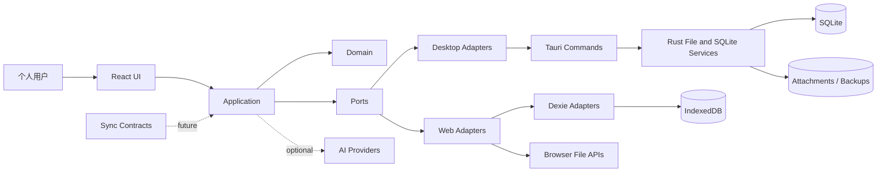

# DailyFlow 系统架构设计

## 1. 目标与约束

DailyFlow V1 必须在 Windows、macOS 和 Web 上实现一致的领域行为，同时允许桌面端和 Web 使用完全不同的持久化技术。

硬约束：

- 桌面端是 Tauri 2 + Rust + SQLite。
- Web 端是 React + IndexedDB + Dexie。
- Domain 与 Application 层不能依赖 React、Tauri、SQLite、Dexie、IndexedDB 或浏览器 API。
- V1 不实现云同步，但标识、版本、删除语义和协议契约必须为后续同步保留空间。
- V1 不引入 NestJS，不搭建云端后端、账号系统或远程 API。
- AI 是可插拔扩展，不能位于保存、读取和导入导出的关键路径。
- Windows、macOS 和 Web 共用领域模型、用例和主要 UI；平台差异只在适配器与组合根。

## 2. 架构原则

1. **依赖倒置**：高层业务规则定义端口，低层存储和平台能力实现端口。
2. **单源数据**：Tiptap JSON 是正文权威来源，Markdown、纯文本、搜索文本均为派生数据。
3. **显式事务**：批量导入、日志保存、附件关联和恢复使用明确原子操作，不依赖隐式自动提交。
4. **接口窄而用例完整**：Repository 不暴露 SQL 或 Dexie 对象，只暴露领域语义。
5. **平台能力端口化**：文件系统、对话框、剪贴板、钥匙串、窗口生命周期均由端口提供。
6. **可重建派生数据**：搜索索引、纯文本、Markdown 缓存、统计快照都能从权威数据重建。
7. **渐进扩展**：同步和 AI 通过独立包接入，不提前建立云端后端。
8. **可测试性**：核心用例使用内存实现即可完成单元测试，不依赖 Tauri 或浏览器。

## 3. 系统上下文



V1 无云端进程。`AI Providers` 默认未配置；即使启用，也不改变本地数据的权威来源。

## 4. Monorepo 分层

```text
apps/
  desktop/
    src/                  # React 组合根、桌面路由、窗口生命周期、Tauri adapter 装配
    src-tauri/            # Tauri 2 Rust 宿主、commands、SQLite、文件存储、备份
  web/
    src/                  # React 组合根、Web 路由、Dexie adapter 装配、浏览器能力
packages/
  domain/                 # 实体、值对象、领域服务、错误、领域事件
  application/            # 用例、端口、查询 DTO、错误映射、事务申请
  infrastructure/         # 平台无关 adapter 公共代码、共享契约、内存实现
  editor/                 # Tiptap Schema、扩展、JSON/Markdown 转换、编辑命令
  ui/                     # 设计令牌、shadcn 基础组件、无业务状态组件
  features/               # 共享页面、功能组件、Zustand 功能状态
  shared/                 # Result、日期、ID、分词、哈希、路径值对象
  sync-contracts/         # 未来同步的版本化 DTO、操作、错误、游标
  ai/                     # Provider 端口实现、请求策略、能力检测
docs/
scripts/
```

### 4.1 各包职责与允许依赖

| 包 | 职责 | 允许依赖 | 禁止依赖 |
| --- | --- | --- | --- |
| `domain` | Journal、Task、Knowledge、Tag、Attachment 元数据、值对象、不变量 | TypeScript 标准能力、`shared` 的纯函数 | React、Tauri、Dexie、SQLite、浏览器 API |
| `application` | 用例编排、端口定义、DTO、权限/策略、事务接口 | `domain`、`shared`、Zod | React、浏览器 API、具体数据库 |
| `infrastructure` | 内存仓储、共享 adapter 工具、DTO 映射、错误分类 | `application`、`domain`、`shared`、Dexie（仅 Web 子入口）、Tauri JS API（仅 Desktop 子入口） | `editor`、具体页面组件 |
| `editor` | Tiptap schema、节点扩展、Markdown 转换、正文分析 | Tiptap、`domain` 的正文值对象、`shared` | 数据库、具体 App 状态 |
| `ui` | 视觉令牌、shadcn 组件、通用布局、可访问性 | React、Tailwind、Radix、Lucide | Repository、Tauri、Dexie |
| `features` | 八个模块的共享页面、功能组件、Zustand 功能 store、页面级测试 | `application`、`domain`、`editor`、`ui`、`shared`、React、Zustand | SQLite、Dexie、Tauri API、具体 adapter、应用组合根 |
| `shared` | 纯工具、日期、ID、Result、分词、哈希抽象 | 无平台 API | 其他业务包 |
| `sync-contracts` | 未来协议 DTO 与版本 | Zod、`shared` | `application`、数据库、React |
| `ai` | Provider 接口实现、能力元数据、安全策略 | `application` 端口、Zod、网络 SDK | `domain` 业务规则、数据库 |
| `apps/desktop` | 桌面组合根、平台能力注入、窗口生命周期 | `features`、`application`、`infrastructure/desktop`、Tauri JS、React | 承载共享业务页面、绕过 Application 直写 SQL |
| `apps/web` | Web 组合根、平台能力注入、浏览器生命周期 | `features`、`application`、`infrastructure/web`、React | 承载共享业务页面、绕过 Application 直写 IndexedDB |
| `apps/desktop/src-tauri` | SQLite、文件、OS 能力实现 | Rust、tauri、rusqlite/sqlx、迁移库 | React/TS 业务逻辑 |

## 5. 分层与调用规则

```text
View / Zustand UI store
        |
        v
Application use case
        |
        +--> Domain entity / value object / policy
        |
        +--> Repository / Service ports
                    |
          +---------+----------+
          |                    |
     Desktop adapter       Web adapter
          |                    |
    Tauri typed commands   Dexie transaction
          |                    |
       Rust + SQLite       IndexedDB
```

### 5.1 UI 层

- `packages/features` 承载 React 页面、功能组件、编辑器视图和交互状态；`packages/ui` 只承载无业务状态的通用组件。
- Zustand 只保存 UI 状态、编辑器临时状态和最近一次用例结果。
- UI 不构造 SQL、不访问 `window.indexedDB`、不直接 `invoke()` Tauri 命令。
- `apps/desktop` 和 `apps/web` 在组合根创建应用服务容器并注入 `packages/features`，共享页面不选择具体存储实现。
- `packages/features/src/routes.ts` 定义共享路径、页面组件、导航元数据和平台无关的路由能力；Web 使用 `BrowserRouter`，桌面使用 `HashRouter`，两个入口只适配 URL/历史行为，不各自复制页面路由表。

### 5.2 Application 层

- 每个用例对应一个显式函数或类，如 `saveJournal`、`importTxtBatch`、`searchAll`。
- 用例负责权限/状态检查、调用领域规则、协调端口、转换错误。
- 不包含 React hooks，不依赖具体存储。
- 查询用例可以直接调用 Query Port 返回只读 DTO，不强行加载完整聚合。
- 输入边界使用 Zod 校验，输出使用应用 DTO，不把数据库行类型暴露给 UI。

### 5.3 Domain 层

- 聚合根：`Journal`、`KnowledgeItem`、`Task`、`ImportSession`、`Report`。
- 值对象：`EntityId`、`LocalDate`、`Revision`、`ContentDocument`、`ContentHash`、`TagName`、`AttachmentRef` 等。
- 领域规则只处理不需要 IO 的不变量和计算。
- 领域错误使用可判别联合或稳定错误码，不携带 HTTP 或 SQLite 错误。

### 5.4 Infrastructure 层

- 实现端口、映射持久化行、执行事务、处理排序、游标和索引维护。
- 平台无关实现与平台专用实现通过子路径导出，防止 bundle 将 Tauri 模块打入 Web。
- 基础设施错误统一映射为 `StorageError`、`NotFoundError`、`ConflictError`、`ValidationError` 等应用可理解类别。

## 6. 关键端口设计

以下接口是设计基线，具体命名可在编码时微调，但语义不可破坏。

```ts
export type EntityId = string;
export type LocalDate = string; // 严格 YYYY-MM-DD，由 LocalDate.parse 校验

export interface JournalRepository {
  getByDate(date: LocalDate): Promise<Journal | null>;
  getById(id: EntityId): Promise<Journal | null>;
  listSummaries(query: JournalListQuery): Promise<Page<JournalSummary>>;
  saveSnapshot(input: SaveJournalSnapshot): Promise<SavedJournalSnapshot>;
  listVersions(journalId: EntityId, page: PageRequest): Promise<Page<JournalVersionSummary>>;
  getVersion(journalId: EntityId, revision: number): Promise<JournalVersion | null>;
  restoreVersion(input: RestoreJournalVersion): Promise<SavedJournalSnapshot>;
  softDelete(journalId: EntityId, expectedRevision: number): Promise<void>;
}

export interface KnowledgeRepository {
  getById(id: EntityId): Promise<KnowledgeItem | null>;
  list(query: KnowledgeListQuery): Promise<Page<KnowledgeSummary>>;
  save(item: KnowledgeItem, expectedRevision: number | null): Promise<KnowledgeItem>;
  softDelete(id: EntityId, expectedRevision: number): Promise<void>;
}

export interface TaskRepository {
  list(query: TaskListQuery): Promise<Page<Task>>;
  save(task: Task, expectedRevision: number | null): Promise<Task>;
  complete(id: EntityId, completedAt: string, expectedRevision: number): Promise<Task>;
  softDelete(id: EntityId, expectedRevision: number): Promise<void>;
}

export interface SearchPort {
  query(input: SearchQuery): Promise<SearchResultPage>;
  rebuild(scope?: SearchScope): Promise<RebuildResult>;
}

export interface AttachmentStore {
  put(input: PutAttachmentInput): Promise<AttachmentRecord>;
  getObjectUrl(attachmentId: EntityId): Promise<string>;
  read(attachmentId: EntityId): Promise<Uint8Array>;
  removeOrphan(attachmentId: EntityId): Promise<void>;
}

export interface FileImportSource {
  scan(root: ImportRoot): Promise<AsyncIterable<RawImportFile>>;
}

export interface ImportStore {
  createSession(input: CreateImportSession): Promise<ImportSession>;
  savePreview(input: SaveImportPreview): Promise<ImportSession>;
  getSession(sessionId: EntityId): Promise<ImportSession | null>;
  commitBatch(input: CommitImportBatch): Promise<ImportCommitResult>;
  recordFailure(input: RecordImportFailure): Promise<void>;
}

export interface BackupService {
  create(options: BackupOptions): Promise<BackupResult>;
  inspect(source: BackupSource): Promise<BackupManifest>;
  restore(source: BackupSource, options: RestoreOptions): Promise<RestoreResult>;
}
```

### 6.1 保存操作的原子契约

日志保存同时影响正文、版本投影、结构化块投影、标签和全文索引。为避免暴露底层事务，Repository 提供业务语义完整的原子方法：

```ts
export interface SaveJournalSnapshot {
  journalId: EntityId;
  journalDate: LocalDate;
  title: string;
  contentJson: JsonDocument;
  contentMarkdown: string;
  contentPlainText: string;
  editorSchemaVersion: number;
  projectionVersion: number;
  expectedRevision: number | null;
  checkpoint: "autosave" | "explicit" | "restore" | "import";
  tags: string[];
  structuredBlocks: StructuredBlockProjection[];
  searchDocuments: SearchDocument[];
  savedAt: string;
}

export interface SavedJournalSnapshot {
  journalId: EntityId;
  revision: number;
  savedAt: string;
  contentHash: string;
  versionCreated: boolean;
  searchIndexState: "ready" | "stale";
}
```

`expectedRevision` 必须使用乐观并发控制。桌面 SQLite 在单个 Rust command 内完成写入；Web 在单个 Dexie transaction 内完成写入。若正文、版本、投影或搜索索引任一步失败，整次保存都不提交，UI 保留草稿并显示可重试错误。`stale` 只用于迁移、恢复或投影版本升级后的全局索引状态，不允许普通保存降级为“正文成功、索引未更新”。

### 6.2 导入事务契约

`ImportStore` 在 Domain/Application 中只暴露业务语义，不暴露 SQL、Dexie 表名或原生事务对象。实现必须遵守以下边界：

```ts
export interface CreateImportSession {
  sessionId: EntityId;
  rootLabel: string;
  options: ImportSessionOptions;
  createdAt: string;
}

export interface SaveImportPreview {
  sessionId: EntityId;
  expectedSessionRevision: number;
  entries: ImportEntryDraft[];
  stats: ImportPreviewStats;
  savedAt: string;
}

export interface CommitImportBatch {
  sessionId: EntityId;
  expectedSessionRevision: number;
  entries: ImportCommitEntry[];
  committedAt: string;
}

export interface RecordImportFailure {
  sessionId: EntityId;
  expectedSessionRevision: number;
  status: "failed" | "rolled_back";
  errorSummary: string;
  failedEntries: ReadonlyArray<{
    entryId: EntityId;
    errorCode: string;
    errorDetail: string;
  }>;
  failedAt: string;
}

export interface ImportCommitResult {
  sessionId: EntityId;
  sessionRevision: number;
  journalCount: number;
  importedEntryCount: number;
}
```

1. `createSession` 是审计事务，只初始化 `scanning` 会话；不创建正式 Journal。
2. `savePreview` 是独立审计事务，原子写入预览条目和统计并把会话推进到 `preview_ready`；失败时保持可重试的 `scanning` 状态。
3. `commitBatch` 先以短审计事务比较 `expectedSessionRevision`，把 `preview_ready` 原子推进为 `committing` 并使 `revision + 1`。该步骤不写正式业务表。
4. 取得 `committing` 状态后，正式数据部分必须在一个 SQLite `BEGIN IMMEDIATE` 或一个 Dexie `rw` transaction 内完成：写入 Journal、版本、结构化投影、标签、搜索文档和附件关联，更新选中条目的 `journalId/status`，最后把会话推进为 `completed` 并再次使 `revision + 1`。正式事务必须验证会话仍为 `committing` 且 revision 未被其他操作改变。
5. `commitBatch` 在正式事务失败时不得返回部分成功。正式事务回滚后，实现必须通过独立的 `recordFailure` 审计事务写入 `failed`/`rolled_back`、`errorSummary` 和逐项错误，再抛出带稳定错误码的 `ImportCommitError`；该审计事务不能写任何正式业务表。
6. 会话每次有效状态变化递增 `revision`。任何 `expectedSessionRevision` 不匹配都返回 `CONFLICT`，禁止同一预览被并发或重复提交。
7. 若失败审计写入也失败，保留 `preview_ready` 或 `committing` 状态并把审计失败作为错误详情返回；应用启动后的恢复检查只允许把中断的 `committing` 会话标记为失败，不能据此补写正式数据。

### 6.3 Query Port

列表和 Dashboard 不通过加载完整日志聚合实现。定义只读查询端口：

- `DashboardQuery`
- `JournalListQuery`
- `TimelineQuery`
- `KnowledgeListQuery`
- `TaskListQuery`
- `AnalyticsQuery`
- `StorageInfoQuery`

查询端口返回应用 DTO，包含 UI 需要的摘要字段，不返回正文 JSON，除非详情页明确请求。

### 6.4 AI Provider 端口

AI 端口定义在 Application 层，具体 Provider 位于 `packages/ai`，只在组合根装配。Application 不依赖任何一个云端 SDK，Domain 不知道 AI 存在。

```ts
export type AiPurpose = "report-summary" | "selection-explain";

export interface AiContextPart {
  label: string;
  text: string;
  sourceEntityId?: EntityId;
}

export interface AiCompletionRequest {
  purpose: AiPurpose;
  systemPolicyVersion: number;
  parts: AiContextPart[];
  locale: string;
  maxOutputTokens: number;
}

export interface AiProviderDescriptor {
  id: string;
  displayName: string;
  capabilities: AiPurpose[];
  sendsDataOffDevice: boolean;
}

export interface AiCancellation {
  readonly aborted: boolean;
  throwIfAborted(): void;
}

export interface AiProviderPort {
  readonly descriptor: AiProviderDescriptor;
  complete(
    request: AiCompletionRequest,
    cancellation: AiCancellation,
  ): Promise<{ text: string; finishReason: "stop" | "length" }>;
}

export interface AiProviderRegistry {
  list(): AiProviderDescriptor[];
  resolve(providerId: string): AiProviderPort | null;
}

export interface SecretStore {
  readonly backend: "os-keychain" | "session-memory";
  get(secretRef: string): Promise<string | null>;
  set(secretRef: string, value: string): Promise<void>;
  delete(secretRef: string): Promise<void>;
}
```

装配规则：

- V1 默认注入只含 `disabled` descriptor 的 `DisabledAiRegistry`；不配置 Provider 时所有核心功能正常工作。
- V1 不交付真实 Provider、厂商 SDK 或网络请求入口；未来可由 `packages/ai` 增加 OpenAI-compatible 等实现。新增 Provider 不应修改 Domain 或 Repository。
- Provider 只接收 `AiCompletionRequest` 的显式片段，不接收 `AppServices`、Repository、完整数据库或附件句柄。
- Provider 返回文本只是草稿，不能绕过保存用例直接写 Journal、Knowledge 或 Report。
- 用户关闭 AI 或 Provider 失败时，UI 回到本地确定性结果，不改变已保存正文。

## 7. 桌面端实现方案

### 7.1 推荐方案

桌面端使用类型化 Tauri command 作为前端与 Rust 持久化层的边界：

```text
React
 -> DesktopJournalRepository (TS)
 -> invoke("journal_save_snapshot", payload)
 -> Rust command validates DTO and opens transaction
 -> SQLite repository + FTS + attachment metadata
 -> typed result
 -> TS mapper converts row DTO to application DTO
```

优点：

- 不把原始 SQL 字符串跨 IPC 传给 WebView。
- Rust 层可安全处理文件路径、附件、备份和事务。
- 前端仍然只依赖 Repository 端口，命令只在 adapter 内出现。
- 可在 Rust 侧对 payload 大小、附件类型和路径做最后一道防护。

代价：

- TS 与 Rust 需要维护 DTO 契约。
- 需要在 CI 中增加契约测试，防止字段漂移。

减少代价的方式：

- 在 `packages/infrastructure/src/desktop/tauri-contracts.ts` 集中声明命令名、请求/响应 Zod schema 和 DTO。
- SQLite 行 DTO 与应用 DTO 分离，Rust 只返回稳定字段名和统一 camelCase 协议字段。
- 通用命令仅用于存储维护，如迁移状态和一致性检查；业务写操作使用语义明确命令。

### 7.2 备选方案与取舍

| 方案 | 优点 | 缺点 | 结论 |
| --- | --- | --- | --- |
| Typed Tauri commands + Rust repository | 安全边界清晰、事务完整、文件能力集中 | 需要维护跨语言契约 | **推荐** |
| `tauri-plugin-sql` 在 TS 中直接执行 SQL | 实现快、TypeScript 端统一 | SQL/事务能力散落前端、附件与备份仍需 Rust、难防误用 | 不推荐作为主方案 |
| Rust 只提供通用 KV/JSON 存储 | 简单 | 查询、全文搜索、迁移和一致性难以扩展 | 不推荐 |

### 7.3 Rust 命令边界

建议命令分组：

- Journal：`journal_get_by_date`、`journal_get`、`journal_list`、`journal_save_snapshot`、`journal_list_versions`、`journal_get_version`、`journal_restore_version`、`journal_soft_delete`。
- Knowledge：`knowledge_get`、`knowledge_list`、`knowledge_save`、`knowledge_soft_delete`。
- Tasks：`task_list`、`task_save`、`task_complete`、`task_soft_delete`。
- Search：`search_query`、`search_rebuild`、`search_status`。
- Attachments：`attachment_put`、`attachment_read`、`attachment_remove`、`attachment_open`。
- Import：`import_scan_txt`、`import_preview`、`import_commit`、`import_get_session`。
- Backup：`backup_create`、`backup_inspect`、`backup_restore`、`backup_validate`。
- Data：`db_health`、`db_migration_status`、`db_export_json`。

命名可以使用 Rust 的 snake_case 命令名，但 payload 字段统一使用 camelCase 并由显式 serde rename 保证。禁止依赖 serde 默认命名造成两端漂移。

## 8. Web 端实现方案

### 8.1 推荐方案

Web 端使用 Dexie 实现仓储与查询端口。每个跨多个 store 的写用例使用 Dexie transaction：

```ts
await db.transaction(
  "rw",
  [db.journals, db.journalVersions, db.structuredBlocks, db.searchDocs, db.tags],
  async () => {
    // 检查 revision、写正文、写版本投影、写搜索文档、写标签
  },
);
```

实际 adapter 不允许把 `db` 暴露给 Application。上述代码只存在于 `packages/infrastructure/src/web`。

### 8.2 浏览器约束

- 使用 `navigator.storage.persist()` 请求持久化，并在 Data Management 显示结果。
- 首次创建数据前检查 `navigator.storage.estimate()`。
- Safari 不支持 File System Access API 时，退回 `<input webkitdirectory>` 扫描；不承诺写入原目录。
- Web 关闭页面无法保证异步写入完成，因此保存间隔更短，并在 `visibilitychange`、`pagehide` 触发尽力保存。
- Web 端大附件受配额限制。超过单文件上限时明确提示，不静默截断。

### 8.3 Web 与桌面共享

以下内容必须共享：

- Domain 实体和规则。
- Application 用例和端口。
- Editor schema、转换器、结构化块 schema。
- 搜索归一化和分词规则。
- UI 组件与页面布局。
- Zod DTO 和错误码。

以下内容允许不同：

- 存储事务实现。
- 文件选择、下载、附件读取。
- 快捷键的修饰键解析。
- 窗口关闭/页面隐藏的生命周期处理。
- 备份归档格式的具体打包器，但 manifest 和内容模型必须一致。

## 9. 应用服务组合

以 `AppServices` 作为应用层容器，不把具体 adapter 放入 Domain：

```ts
export interface AppServices {
  journals: JournalRepository;
  knowledge: KnowledgeRepository;
  tasks: TaskRepository;
  search: SearchPort;
  attachments: AttachmentStore;
  imports: ImportService;
  backups: BackupService;
  analytics: AnalyticsQuery;
  dashboard: DashboardQuery;
  clock: Clock;
  ids: IdGenerator;
}

export function createWebServices(): AppServices {
  const db = createDexieDatabase();
  return {
    journals: new DexieJournalRepository(db),
    knowledge: new DexieKnowledgeRepository(db),
    tasks: new DexieTaskRepository(db),
    search: new DexieSearchPort(db),
    attachments: new WebAttachmentStore(db),
    imports: new BrowserImportService(),
    backups: new WebBackupService(db),
    analytics: new DexieAnalyticsQuery(db),
    dashboard: new DexieDashboardQuery(db),
    clock: new SystemClock(),
    ids: new UuidV7Generator(),
  };
}
```

桌面端 `createDesktopServices()` 使用 Tauri adapter 替换存储相关实现。任何页面只能依赖 `AppServices` 接口，不能根据 `isTauri` 分支自行选数据库。

## 10. 关键业务流

### 10.1 打开日志

```text
UI 路由 -> GetJournalByDate
  -> JournalRepository.getByDate
  -> 若不存在，生成未保存的新 Journal DTO
  -> Editor 从 contentJson 初始化
  -> 若 JSON schemaVersion 过旧，应用迁移/重解析
```

打开不自动创建数据库行，避免用户只是查看就生成空日志。首次保存时才落库。

### 10.2 自动保存

```text
编辑器变更
  -> 800ms debounce
  -> Editor serializer 生成 JSON/Markdown/plain
  -> SaveJournal 校验 LocalDate、schemaVersion、revision
  -> Repository 原子保存正文、版本检查点、结构化投影、标签、搜索文档
  -> 返回 revision 与 savedAt
  -> UI 更新保存状态
```

详细冲突策略见 `EDITOR-DESIGN.md`。

### 10.3 从日志提升知识条目

1. 用户在日志块或选区上选择“沉淀为知识”。
2. `PromoteBlockToKnowledge` 读取来源快照并创建未保存草稿。
3. 用户确认类型、标题和正文。
4. `KnowledgeRepository.save` 写入知识条目和来源关联。
5. 原日志不变；可选地在日志中插入 `[[knowledge:id]]` 引用节点。

来源关联与正文复制分离，之后修改知识条目不会静默改写原日志。

### 10.4 导入

1. 平台 `FileImportSource` 扫描目录并返回异步文件记录。
2. 应用层检测编码、日期、哈希、冲突，生成预览 DTO。
3. 扫描先创建 `scanning` 的 ImportSession；预览结果再以独立审计事务保存 ImportEntry，不创建正式 Journal。
4. 用户确认后，`ImportStore.commitBatch` 先在短审计事务中校验 `expectedSessionRevision` 并进入 `committing`。
5. 桌面在单个 SQLite 事务中、Web 在单个 Dexie transaction 中写入正式数据、更新选中条目并完成会话；该事务不能产生部分 Journal。
6. 正式事务失败时只回滚正式数据，再用独立审计事务记录失败状态和逐项错误；启动恢复只能处理遗留的 `committing` 审计状态。

### 10.5 备份与恢复

备份是数据治理能力，不是数据库文件复制 UI：

- 桌面快速备份使用 SQLite 一致性快照，另可生成跨平台可移植包。
- Web 生成带 manifest 的归档。
- 恢复先校验 manifest、schema 版本和内容哈希，再写入临时区或事务。
- 恢复失败必须保留当前数据；V1 不支持对当前库进行未经校验的原文件覆盖。

## 11. 事务与一致性

### 11.1 原子操作清单

| 操作 | SQLite | IndexedDB |
| --- | --- | --- |
| 日志保存 | 单 Rust command + `BEGIN IMMEDIATE` | 单 Dexie `rw` transaction |
| 日志恢复 | 读取版本后单事务写入新 revision | 同一事务读版本、写新版本 |
| 导入提交 | 扫描/预览审计先落库；短事务进入 `committing`；正式 Journal/版本/投影/索引与选定条目状态单事务提交 | 扫描/预览审计先落库；短事务进入 `committing`；正式 stores 单 Dexie transaction |
| 知识提升 | 单事务写知识条目与来源关联 | 单 transaction |
| 任务完成 | 单事务更新任务与关联摘要 | 单 transaction |
| 附件入库 | 先写临时文件，再事务登记 metadata | Blob 与 metadata 在同一事务 |
| 备份 | 一致性快照，不持锁导出业务表 | 读事务/快照式遍历 |

### 11.2 一致性策略

- 所有实体使用 UUIDv7 或服务端未来分配的稳定 ID，不使用自增 ID 作为外部标识。
- 每个可变聚合有单调递增 `revision`。
- 删除使用 `deleted_at` 软删除；未来同步可复用 tombstone，不实现物理删除语义。
- 时间戳存储 UTC ISO 8601；业务日期存储用户本地 `LocalDate`，两者不可混用。
- JSON 使用规范化序列化，保存前计算 SHA-256 内容哈希。
- 派生数据损坏时可标记 `stale`，由后台重建，不阻塞正文打开。

### 11.3 SQLite 设置

建议在连接初始化时执行：

```sql
PRAGMA foreign_keys = ON;
PRAGMA journal_mode = WAL;
PRAGMA synchronous = NORMAL;
PRAGMA busy_timeout = 5000;
PRAGMA temp_store = MEMORY;
```

`NORMAL` 在 WAL 下兼顾日常编辑吞吐；备份、导入和迁移使用显式事务与一致性校验。若实测出现掉电损坏风险，可把保存连接切换为 `FULL`，这是后续性能调优决策。

### 11.4 版本与检查点

- `revision` 每次成功保存递增，用于并发控制和同步顺序。
- `journal_versions` 不是每次按键或每 800ms 保存都追加，避免版本爆炸。
- 建议自动保存检查点最多每 5 分钟或每 100 次变更取一次；手动保存、关闭、导入、恢复和显式快照立即追加。
- 当前正文始终在 `journals`，历史检查点在 `journal_versions`。
- 保留策略可由设置配置，默认最近 100 个检查点或 180 天，先由 ADR 约束实现。

## 12. 编辑器与存储边界

- `packages/editor` 只认识 Tiptap schema 和内容转换，不认识 Repository。
- 保存用例接收经过 Zod 校验的 `JsonDocument`，不直接接收 Tiptap Editor 实例。
- Tiptap Editor 状态由编辑器组件持有，Zustand 只存保存状态和必要的 UI 元数据。
- 派生字段由 `ContentProjector` 生成，Repository 只持久化结果，不自行解析富文本。
- 任何导入路径先生成权威 JSON，再调用同一个保存用例，不能创建第二套写入管线。

## 13. 错误处理

统一错误类型：

```ts
export type AppError =
  | { code: "VALIDATION_ERROR"; message: string; fields?: Record<string, string> }
  | { code: "NOT_FOUND"; entity: string; id: string }
  | { code: "CONFLICT"; entity: string; expectedRevision: number; actualRevision: number }
  | { code: "STORAGE_UNAVAILABLE"; retryable: boolean; cause?: string }
  | { code: "QUOTA_EXCEEDED"; requiredBytes?: number }
  | { code: "IMPORT_FAILED"; batchId?: string; details: ImportError[] }
  | { code: "MIGRATION_FAILED"; fromVersion: number; toVersion: number }
  | { code: "BACKUP_INVALID"; reason: string }
  | { code: "AI_UNAVAILABLE"; providerId: string; reason: string };
```

规则：

- Domain 只返回领域错误或原因码。
- Application 决定是否可重试、如何呈现、是否保留草稿。
- Infrastructure 把 SQLite、IndexedDB、文件系统异常映射为稳定错误，UI 不解析原始错误字符串。
- 保存失败不清理编辑缓冲区；导入失败返回批次级错误摘要和逐项错误。

## 14. 安全设计

- Tauri CSP 只允许本地资源和明确的外部链接。
- 文件路径在 Rust 侧解析、规范化和限制到应用数据目录或用户明确选择的导入根目录。
- 不接受来自富文本的任意 `file://` 链接。
- 附件使用内容哈希和随机存储名，不使用原始文件名作为路径。
- 导出时对文件名做跨平台净化，并保留原始显示名。
- Web 端第三方 AI Key 不长期明文存储；桌面优先使用系统钥匙串适配器。
- 日志正文、附件和导入原始内容默认不离开设备。

### 14.1 AI 调用安全规则

1. AI 默认关闭，每次外部调用都由用户显式发起，不在后台自动摘要、索引或改写正文。
2. 发起前 UI 必须展示 Provider、目标、用途、将发送的文本范围、是否包含代码块，以及可能产生的费用。
3. 上下文只包含用户选中的片段或本次报告统计；不默认发送附件、完整历史、导入原始字节、路径、标签全集或数据库内容。
4. API Key 通过 `SecretStore` 写入系统钥匙串；Web 端只放当前标签页内存或要求每次重新输入，禁止写入 IndexedDB、`localStorage` 或备份。
5. 请求支持取消、超时和输出长度上限。Provider 错误映射为 `AI_UNAVAILABLE`，不能使页面或本地数据不可用。
6. 诊断日志只记录 Provider ID、耗时、错误码和字符数，不记录 Prompt、响应、Key 或用户正文。

## 15. 跨平台运行差异

| 关注点 | Windows | macOS | Web |
| --- | --- | --- | --- |
| 窗口/宿主 | WebView2 Evergreen | WKWebView | 浏览器标签页 |
| 存储 | SQLite 文件 | SQLite 文件 | IndexedDB |
| 应用数据目录 | Tauri `app_data_dir` | Tauri `app_data_dir` | Origin 绑定的 IndexedDB |
| 文件选择 | 原生对话框 | 原生对话框 | File System Access 或 `<input>` |
| 关闭保存 | Tauri `onCloseRequested` 拦截 | 同一机制 | `visibilitychange`/`pagehide` 尽力保存 |
| 快捷键 | Ctrl | Cmd | Meta/Ctrl 自动识别 |
| 签名 | Authenticode | Developer ID + notarization | HTTPS 部署与 CSP |
| 附件 | 本地文件 | 本地文件 | IndexedDB Blob |

更详细的构建与测试矩阵见 `DEVELOPMENT-GUIDE.md` 和 `DEVELOPMENT-PLAN.md`。

## 16. 可观察性与诊断

- 结构化日志分级别，生产默认只记录错误和关键生命周期，不记录正文。
- 数据健康检查包括：迁移版本、外键、重复日期、孤立附件、索引状态、备份年龄。
- 用户可导出诊断包，包含应用版本、平台、schema 版本和错误摘要，不含正文。
- 性能埋点只写本地实验数据，V1 不上传。

## 17. 测试策略

| 层 | 工具 | 重点 |
| --- | --- | --- |
| Domain | Vitest | 日期、revision、哈希、状态流转、错误分支 |
| Application | Vitest + 内存 adapter | 保存冲突、导入回滚、提升知识、删除恢复 |
| Editor | Vitest + jsdom | JSON/Markdown round-trip、schema 迁移、粘贴解析 |
| Web storage | Vitest + fake-indexeddb | Dexie transaction、迁移、查询、配额错误 |
| Desktop storage | Rust `cargo test` + 临时 SQLite | 事务、迁移、FTS、附件路径、备份校验 |
| Contract | Vitest/JSON fixtures | TS DTO 与 Rust fixture 字段一致 |
| UI | Vitest + Testing Library | 用户可见状态、键盘和可访问性 |
| Web E2E | Playwright | 导入、编辑、搜索、备份下载 |
| Desktop E2E | 平台冒烟测试 + 可自动化部分 | 安装、启动、保存、导入、备份、关闭拦截 |

核心业务测试不能依赖 Tauri 或浏览器真实实现；跨端 adapter 测试必须使用真实 SQLite/IndexedDB 或等价的高保真测试实现。

## 18. 部署与发布边界

V1 不部署云端服务：

- Web 作为静态 SPA 构建输出，可部署到任意静态站点；若使用远端托管，数据仍只保存在浏览器。
- Windows 和 macOS 发布签名安装包。
- 桌面自动更新不在 V1 核心要求内；更新机制若加入，必须独立 ADR。
- Linux 可以编译尝试，不进入发布阻断矩阵。
- 未来同步服务需新增独立服务端仓库或应用，不得让 V1 Web/Desktop 构建依赖云后端才能启动。

## 19. 架构决策摘要

1. Tiptap JSON 是唯一权威正文，Markdown 是派生。
2. 桌面使用类型化 Tauri commands 封装 Rust/SQLite。
3. Web 使用 Dexie transaction 保证多 store 原子性。
4. Repository 提供业务级原子方法，避免把底层事务泄漏给 UI。
5. UUIDv7、revision、UTC 时间戳、LocalDate 和软删除为未来同步预留。
6. 搜索使用 `SearchPort`，两端分别实现，共享分词规则。
7. 导入先预览后事务提交，原始字节保留。
8. AI 作为独立包和端口，不进入核心依赖图。

